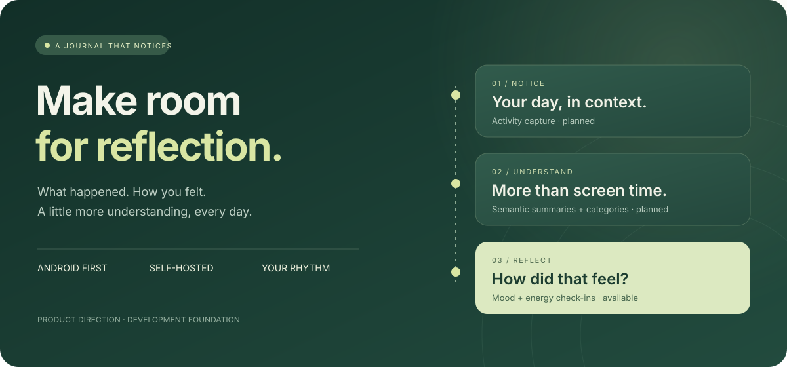

<div align="center">
  <picture>
    <source media="(prefers-color-scheme: dark)" srcset="docs/assets/wordmark-dark.svg">
    
  </picture>

  <p><strong>A private activity journal for Android and the web.</strong></p>

  <p>
    Capture your context, review your day, and understand your rhythm.<br>
    Inspired by Dayflow, designed around a phone's battery and your privacy.
  </p>

  <p>
    <a href="https://github.com/skyhong2002/PocketLog/actions/workflows/check.yml"></a>
    <a href="LICENSE"></a>
  </p>
</div>

> **Early development.** The timeline reader and self-hosted API
> now include opt-in app/context capture, encrypted offline sync, editable activity
> cards, a private responsive website and BYO AI. The website follows the
> [simplified product](docs/ux/SIMPLIFIED_IA.md) (2026-11-17): only 時間軸, 回顧 and
> 設定, with AI recaps and asking the AI inside 回顧; the Android app has not been
> simplified yet. Custom categories/rules and revocable device keys are available;
> full desktop Dayflow parity is not shipped. Real-device capture and full-day
> battery validation are still required. There is no stable release yet.

## Your Day, in Context

Two hours in a messaging app could mean planning a project, talking to friends,
or reading the news. PocketLog aims to turn those fragments into a timeline you
can review, categorize, and correct.

<p align="center">
  
  <br><sub>Product concept, not a screenshot of the current app.</sub>
</p>

## Find Your Day Again

Capture phone context with explicit consent, review activity cards on a timeline,
and correct their categories. BYO AI and the private API help connect that context
to your own tools. Manual mood entry is no longer part of the app.

## Features

| Feature | Status |
| --- | --- |
| Onboarding | Three skippable steps on both clients: what is and is never captured, connect your AI, then start recording (phone) or connect the Android app (web) |
| Timeline and review | Exactly three destinations on Android and the website: 時間軸 (one status line, recorded time with a stacked category bar, AI-understood cards, 04:00 day boundary; the web keeps an hourly grid on desktop) / 回顧 (day/week AI recap, time split, top apps, topics, 問 AI) / 設定 |
| Manual journaling | Removed from both clients on 2026-11-17 (reflections, mood, daily rating, Flow, Agents); APIs and stored data kept |
| Private Android connection | HTTPS, no redirects, Keystore-protected credentials |
| Self-hosted storage | Rust API + isolated worker, SQLite, Docker Compose; permanent journal, owner storage budget (default 10 GB) that removes oldest screenshots first, deletion |
| App activity recording | Opt-in incremental UsageStats, pause, sensitive-app and custom exclusions |
| Screen text and screenshots | Opt-in with an app allowlist through one guided 自動記錄 flow; screenshots on by default (can be turned off); every 10 s and on app switch, 720 px; unchanged screens skipped; protected/DRM windows kept as text only (`protected_screen`) |
| Activity cards and AI | Source labels AI 整理 / 畫面文字 / 只有 app / 你改過, plus AI 整理中 and 受保護畫面（無截圖）; one-tap category edits; Mika-style AI setup on both clients (OpenAI, Anthropic, Google Gemini, OpenRouter, DeepSeek or a custom OpenAI-compatible endpoint such as Ollama) with test-and-save, a provider-bound automatic-summary switch and an optional daily recap |
| Battery and offline queue | AES-GCM queue/cache with retries and quarantine; screen captures upload while charging (or on unmetered networks above 256 MB) and are kept up to 72 h, other writes 24 h |
| Export | Private JSON from 設定 › 資料 on both clients |
| Device credentials | Owner-issued journal/collector keys, expiry and individual revocation; phone Keystore storage |
| Short-term image replay | Independent opt-in; worker-sanitized 480 px thumbnails, 24 hours / 256 images |
| infovore publishing | Not enabled; PocketLog operates independently |

See the [infovore port coverage](docs/INFOVORE_PORT.md), [analysis setup](docs/ANALYSIS.md),
[Dayflow feature matrix](docs/DAYFLOW_PARITY.md), [UI guidelines](docs/UI_GUIDELINES.md),
[synthetic UI acceptance captures](docs/ux/ACCEPTANCE.md), and [roadmap](docs/ROADMAP.md)
for exact boundaries, verified interface states and remaining work.

## Privacy

PocketLog separates a lightweight Android client from a server you control.
Heavier analysis runs in a separate server worker. No external AI provider is
configured by default; model processing requires explicit provider setup and
the owner turning on automatic summaries for that provider. Native Anthropic Messages and Gemini generateContent
are supported alongside OpenAI-compatible endpoints. No CLI process is executed. There are no analytics or public journal endpoints.

Credentials are protected by Android Keystore. The API authenticates journal
requests and limits input size, storage, and retention. The current server is
single-owner. Keep the owner token for recovery/browser login, and issue separate
expiring journal/collector keys for devices; keys can be individually revoked.

SQLite is not encrypted by the application: use encrypted host storage and
backups. A server that analyzes your activity can read it. This is not end-to-end
encryption against the server, and the project has not had an independent security
audit. Read the [security boundaries](docs/SECURITY.md) before deploying.

## Build From Source

Requirements: Android 14+, JDK 17+, Android SDK 36, and Docker Compose for the server.
Rust development requires stable Rust (minimum 1.90).

```sh
git clone https://github.com/skyhong2002/PocketLog.git
cd PocketLog

# Start the private development API on localhost:18748.
./scripts/init-secret.sh
docker compose up --build -d

# Build the Android app.
cd android
./gradlew assembleDebug
```

For bounded checks and an isolated phone build that preserves an existing
installation, see [development setup](docs/DEVELOPMENT.md).

Put the service behind a trusted HTTPS proxy or Tailscale Serve. Open its HTTPS
origin in a browser and sign in with the owner key to complete onboarding. In
Settings → Connection and devices, create a journal device key for your phone;
enter that key and the same HTTPS origin in the Android app. Keep the owner key
for website login and recovery. See [setup](docs/SETUP.md) for secret handling and
deployment details. The new app does not connect to the old infovore
phone API or migrate its history.

## Research

The design draws on [Dayflow](https://github.com/JerryZLiu/Dayflow)'s activity
review, [ActivityWatch](https://github.com/ActivityWatch/aw-android)'s event
collection. Capturing a screen, understanding its contents, and reviewing a day
are separate capabilities.

Our [11-project comparison](docs/research/comparison-audit.md) documents those
differences with source-code references, including AWARE's screenshot capture
and the distinction between desktop and mobile features. The original research
is in Traditional Chinese; an [interactive table](docs/research/comparison.html)
can be downloaded and opened locally. Findings are dated November 14, 2026;
real-device battery performance was not tested.

## Contributing

Issues and pull requests are welcome. For larger changes, open an issue to discuss
the scope first. Start with the [architecture](docs/ARCHITECTURE.md),
[roadmap](docs/ROADMAP.md), and [engineering guidelines](AGENTS.md).
See the [API reference](docs/API.md) for the current contract.

## License

PocketLog is licensed under the [MIT License](LICENSE).
Third-party components retain their own licenses; see [notices](THIRD_PARTY_NOTICES.md).
