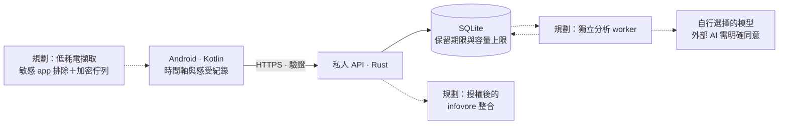

<p align="center">
  <picture>
    <source media="(prefers-color-scheme: dark)" srcset="docs/assets/wordmark-dark.svg">
    
  </picture>
</p>

<h1 align="center">See your day. Understand your rhythm.</h1>

<p align="center">
  回看一天，理解自己的節奏。<br>
  為 Android 打造的私人活動日誌，把做過的事與當時的感受放在一起回顧。
</p>

<p align="center">
  <a href="https://github.com/skyhong2002/PocketLog/actions/workflows/check.yml"></a>
  <a href="android/app/build.gradle.kts"></a>
  <a href="android/build.gradle.kts"></a>
  <a href="server/Cargo.toml"></a>
  <a href="compose.yaml"></a>
</p>

<p align="center">
  <a href="#為什麼做-pocketlog">為什麼做</a> ·
  <a href="#功能與進度">功能與進度</a> ·
  <a href="#從其他工具學到什麼">工具比較</a> ·
  <a href="#架構">架構</a> ·
  <a href="#快速開始">快速開始</a> ·
  <a href="#文件">文件</a>
</p>

<p align="center">
  
</p>

<p align="center"><sub>產品方向示意，非目前 App 截圖。PocketLog 正處於開發基礎階段。</sub></p>

## 為什麼做 PocketLog

「今天用了 Telegram 兩小時」只是起點。我們想回顧的是：那段時間在討論專案、與朋友聊天，還是閱讀新聞？做完之後，是恢復精神，還是感到疲憊？

PocketLog 希望把 **Dayflow 式的活動理解與時間軸** 帶到手機，同時把手機的電量、私人內容與使用者的感受放在核心位置。目標是協助理解生活節奏；休息、娛樂與社交都有自己的價值。

<table>
  <tr>
    <td width="33%" valign="top"><b>◷ 回看做過的事</b><br><br>按一天展開的活動卡片、情境摘要與分類，保留可以修正的空間。</td>
    <td width="33%" valign="top"><b>♡ 記下當時的感受</b><br><br>由自己記錄心情與精神，逐漸理解哪些事情滋養或消耗自己。</td>
    <td width="33%" valign="top"><b>⌁ 留住手機的電量</b><br><br>手機負責有上限的擷取與同步，較重的理解與整理交給私人伺服器。</td>
  </tr>
</table>

> [!IMPORTANT]
> **目前是可建置的開發基礎，尚未具備完整的自動日誌體驗。** 自動活動／畫面擷取、AI 摘要與每日回顧仍待開發。既有 infovore 安裝與 APK 尚未遷移。

## 功能與進度

**已有初版** 表示程式與相關基礎驗證已存在；不代表已完成獨立安全審查或長期實機驗證。**規劃中** 是產品目標，尚未提供。

| 功能 | 希望帶來的體驗 | 目前狀態 |
| --- | --- | --- |
| 每日時間軸 | 回看一天的活動；手機本地時區、凌晨 4 點分日 | **已有初版**：讀取 API 內的活動，尚無自動擷取 |
| 心情與精神 | 快速記下當下感受，與活動放在一起回顧 | **已有初版**：1–5 分自述紀錄 |
| 私人連線 | 連上自己的伺服器；憑證留在安全儲存區 | **已有初版**：HTTPS、Keystore、禁止憑證跟隨重新導向 |
| 自架服務 | 紀錄留在自己選擇的電腦、NAS 或 VPS | **已有初版**：Rust API、SQLite、Docker Compose |
| 保留期限與刪除 | 控制資料量與保存期間 | **已有初版**：固定 30 天、容量上限、刪除 API |
| 自動活動擷取 | 低耗電建立 app 使用時段，減少手動記錄 | **規劃中**：系統事件、敏感 app 排除、暫停控制 |
| 畫面情境理解 | 分辨同一個 app 裡正在做的不同事情 | **規劃中**：明確同意後擷取；伺服器分析 |
| AI 摘要與分類 | 合併片段，整理成可修改的活動卡片 | **規劃中**：獨立 worker、可選模型端點 |
| 每日回顧 | 把活動與自述感受一起看，留下明天的小調整 | **規劃中**；不從使用時間推斷情緒或診斷 |
| 離線與省電 | 沒網路也能暫存、回顧；恢復連線後批次同步 | **規劃中**：加密有上限的佇列、快取與耗電量測 |
| 裝置授權與資料帶走 | 配對／撤銷裝置、匯出、備份與還原 | **規劃中**；目前為單一 owner token |
| infovore 整合 | 自己選擇哪些摘要可以出現在其他地方 | **規劃中**：獨立、需明確授權的 connector |

實作順序見 [開發路線](docs/ROADMAP.md)。

## 從其他工具學到什麼

先前比較涵蓋 **11 個專案、15 個功能面向**，包含擷取、內容理解、分類、感受、搜尋、運算與儲存位置。以下保留最影響 PocketLog 設計的差異。

| 專案 | 主要取得什麼 | 理解／分類方式 | 對 PocketLog 的啟發 |
| --- | --- | --- | --- |
| [ActivityWatch Android](https://github.com/ActivityWatch/aw-android) | app 使用事件、條件式網頁／媒體資訊 | 規則分類；核對路徑未見自動截圖理解 | 用系統事件建立活動骨架；事件與內容理解需分開設計 |
| [AWARE](https://github.com/awareframework/aware-client) | 感測器、app 事件、問卷；有定時截圖程式碼 | 研究框架／外掛；未見核心截圖 AI 摘要 | 可參考擷取、採樣與同步；擷取本身不等於理解 |
| [Dayflow](https://github.com/JerryZLiu/Dayflow) | **macOS** 畫面與輔助情境 | 畫面 AI 分析、活動卡片與分類 | 借鏡回顧流程；手機的權限與電量需重新設計 |
| [Daily You](https://github.com/Demizo/Daily_You) | 手動日記、心情、標籤與附件 | 使用者輸入與本機統計 | 把自述感受當成獨立資料，不讓 AI 代替使用者決定 |
| [Memex](https://github.com/memex-lab/memex) | 主動輸入／匯入文字、照片與語音 | 模型整理卡片、標籤與洞察 | 借鏡生活片段整理；主動輸入與被動記錄是不同管線 |
| [Omi](https://github.com/BasedHardware/omi) | 手機／穿戴音訊；桌面另有畫面 | 對話摘要、任務與記憶；有部分裝置端處理 | 借鏡收集與後端處理分工，避免把桌面能力當成手機能力 |
| [Mindful](https://github.com/akaMrNagar/Mindful) | 使用統計、無障礙 UI 事件 | 規則、限制與使用者設定 | 借鏡使用節奏與暫停控制；目前核對未見畫面語意日誌 |
| [MemoryVoid](https://github.com/dhruvpitroda20-code/MemoryVoid) | 手動按鍵／手勢觸發截圖與錄音 | 手動標籤、筆記 | 手動保留重要片刻也有價值，不必所有內容都自動擷取 |
| [Beiwe](https://github.com/onnela-lab/beiwe-android) | 感測器、問卷與研究資料 | 分析由研究端整合 | 借鏡採樣、感受問卷與上傳條件 |
| [OpenRecall](https://github.com/openrecall/openrecall) | **桌面** 定期截圖、app／標題 | 本機 OCR、文字向量與語意搜尋 | 找回看過的內容與整理一天，是不同的產品能力 |
| [Screenpipe](https://github.com/screenpipe/screenpipe) | **桌面** 畫面、文字、音訊與互動 | 本機索引＋可選 AI 工作流 | 借鏡事件驅動與分層處理；另須注意目前的 source-available 授權 |

**PocketLog 要串起的是「手機活動 → 可理解的日誌 → 自述感受 → 每日回顧」**。這是開發方向，不是宣稱目前已超越上述工具；各專案也有自己的用途與優勢。

<details>
<summary><b>比較依據、限制與互動表</b></summary>

- [完整核對紀錄](docs/research/comparison-audit.md)：固定來源 commit、逐項說明與程式碼連結。
- [互動比較表 HTML](docs/research/comparison.html)：下載或 clone 後以瀏覽器開啟，可搜尋、篩選、切換功能欄位及查看來源。GitHub 檔案頁不會直接執行互動頁面。
- 核對日期為 **2026-11-14**，基於原始碼與官方文件，未安裝所有工具或量測實機耗電。
- 「未見內建」不等於所有版本／外掛都不支援；「未確認」不代表沒有；「原始碼支援」不等於已驗證能在新版 Android 正常運作。
- AWARE 已確認有定時截圖程式碼；Omi 有部分裝置端音訊處理；桌面能力不能直接視為手機能力。
- 這份資料涵蓋開源與 source-available 專案，引用作為研究，不表示 PocketLog 採用其程式碼或授權。

</details>

## 架構



實線為目前資料路徑，虛線為後續規劃。手機保留有上限的暫存與回顧快取；較重的分析留在伺服器。完整架構見 [Architecture](docs/ARCHITECTURE.md)。

**自架只需部署提供的服務，不必自己寫後端。** 可以放在自己的電腦、NAS 或 VPS；未來的純手機基本模式另見路線圖。

## 私人資料的界線

- **目前沒有外部 AI 呼叫、分析追蹤或公開日誌端點。** 自動擷取尚未啟用；未來需獨立同意與擷取前排除。
- **手機憑證使用 Android Keystore 保護。** 需要有效 HTTPS，不放寬憑證驗證；不讓重新導向把金鑰帶到其他來源。
- **伺服器設有驗證、嚴格 schema、輸入／資料量限制與保留期限。** Docker 使用非 root、唯讀根檔案系統及 loopback 連接埠。
- **目前 SQLite 並未內建加密。** 部署需使用加密磁碟與備份；伺服器管理者仍能讀取日誌。伺服器分析不等於防範伺服器的端對端加密。
- **目前是一人一個 instance、單一 owner token。** 裝置配對、分權與撤銷待完成；尚未經獨立安全審查。

完整威脅邊界與限制見 [Security](docs/SECURITY.md)。

## 快速開始

需要 Docker Compose、OpenSSL，以及可信任的 HTTPS reverse proxy 或 Tailscale Serve。Repo 目前為私人專案，需要 GitHub 存取權限。

```sh
git clone https://github.com/skyhong2002/PocketLog.git
cd PocketLog
./scripts/init-secret.sh
docker compose up --build -d
curl --fail http://127.0.0.1:18748/healthz
```

將 loopback 的 `18748` 交給 HTTPS proxy 或 Tailscale Serve，再在 App 設定來源網址與 owner token。金鑰放在 `.secrets/owner_token`，初始化不會列印；請透過私人管道移轉，勿放入 URL、截圖或 Git。

> [!NOTE]
> 這是 PocketLog 開發服務；新 App 尚未相容舊 infovore phone API。部署不會複製既有手機紀錄，也不會啟用 AI。請先閱讀 [完整啟動說明](docs/SETUP.md)。

## 開發與驗證

Android 14+、JDK 17+、Android SDK 36；Rust stable（最低 1.90）。

```sh
# Android：測試、APK 建置與 lint
cd android
./gradlew testDebugUnitTest assembleDebug lintDebug

# Rust：格式、靜態檢查與 API 測試
cd ../server
cargo fmt --check
cargo clippy --locked --all-targets -- -D warnings
cargo test --locked
```

CI 另執行 RustSec 相依漏洞掃描與 Docker 建置。尚未發布正式 APK、預建容器映像或穩定版；目前可從原始碼建置。

## 文件

| 主題 | 文件 |
| --- | --- |
| 產品與開發順序 | [Roadmap](docs/ROADMAP.md) |
| 運算、儲存與資料生命週期 | [Architecture](docs/ARCHITECTURE.md) |
| 權限、信任邊界與已知限制 | [Security](docs/SECURITY.md) |
| 自架與連線 | [Setup](docs/SETUP.md) |
| API、保留期限與配額 | [API v1](docs/API.md) |
| 11 個工具的研究與來源 | [比較核對紀錄](docs/research/comparison-audit.md) · [互動 HTML](docs/research/comparison.html) |
| 專案來源與工程慣例 | [Origin](docs/ORIGIN.md) · [AGENTS.md](AGENTS.md) |

## 授權

目前 repo 為私人專案，尚未指定開源授權。研究引用不代表採用其他專案的授權或程式碼。
